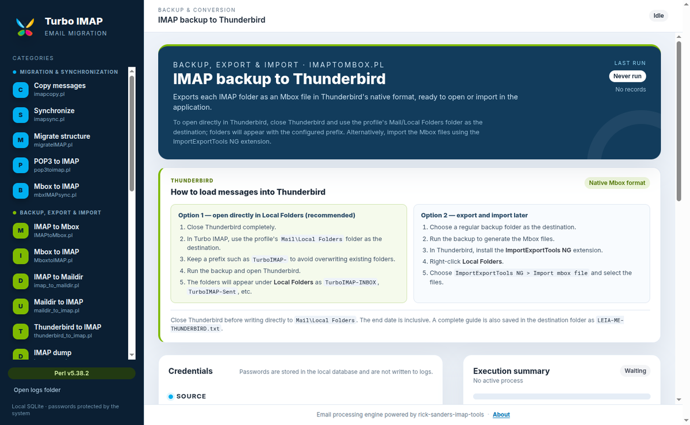
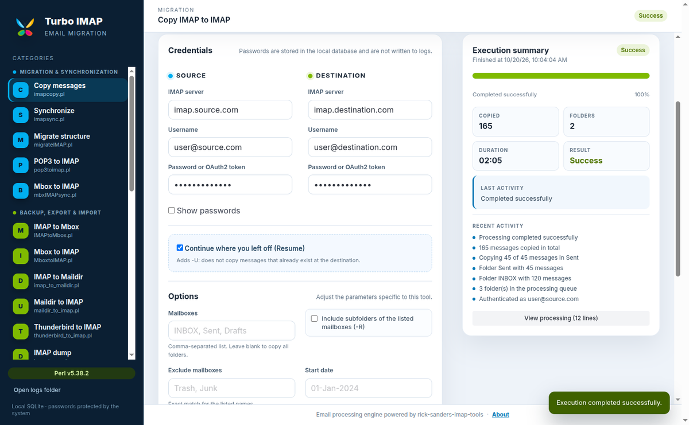
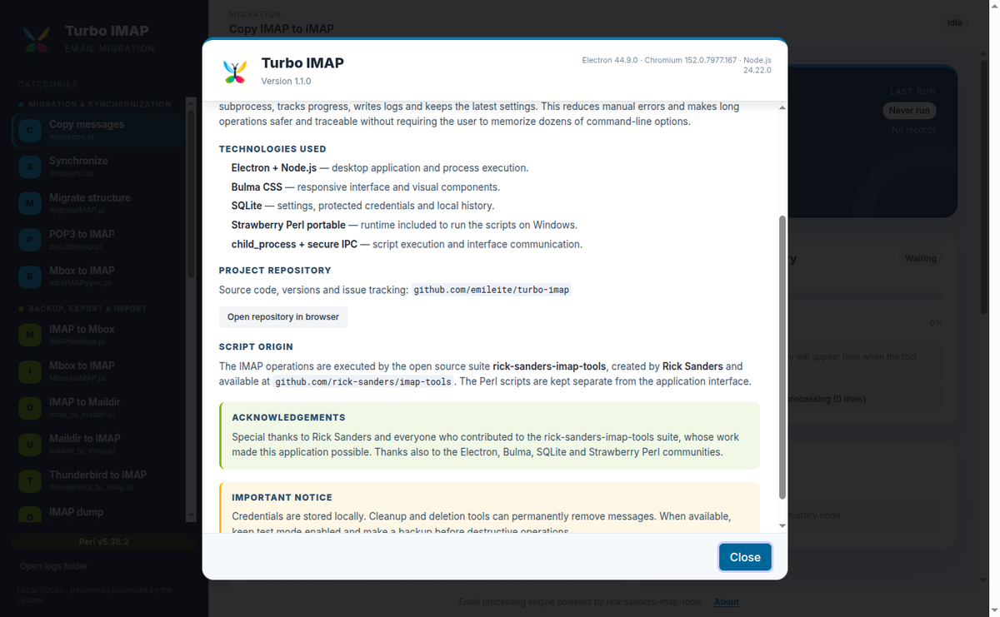

# Turbo IMAP

**English** | [Português (Brasil)](README.pt-BR.md)


Desktop application for **migration, backup, export, import, cleanup and diagnostics of
IMAP email accounts**, with a graphical interface available in English and Portuguese.

Turbo IMAP brings the open source
[rick-sanders-imap-tools](https://github.com/rick-sanders/imap-tools) suite into guided
forms, runs the Perl scripts in subprocesses, tracks progress, writes logs and keeps a
history of every tool.

The interface follows the computer language: **Portuguese (`pt-BR`)** when the system
language is Portuguese, otherwise **English (`en`)**.

**Official repository:** <https://github.com/emileite/turbo-imap>  
**Website:** [English](https://emileite.github.io/turbo-imap/) | [Português](https://emileite.github.io/turbo-imap/pt.html)  
**Downloads:** [Releases](https://github.com/emileite/turbo-imap/releases)

---

## Screenshots

### Main screen



### Friendly execution summary

The full terminal output stays collapsed under **View processing**, while the summary
shows progress, messages, folders, duration, result and recent activity.



### About dialog



<p align="center">
  
</p>

---

## What Turbo IMAP does

- Detects the system language: Portuguese (`pt-BR`) or English (`en`).
- Organizes 25 tools into four categories: migration, backup/conversion, cleanup and
  audit/diagnostics.
- Builds a specific form for each script, with field validation and safe argument
  construction.
- Stores credentials and the latest configuration for each tool in SQLite.
- Runs the Perl scripts in subprocesses without freezing the interface.
- Shows a friendly summary and keeps the complete terminal output in a collapsible block.
- Writes complete logs per run and JSON progress snapshots.
- Supports canceling a running process.
- Offers start/end date filters on tools that support a date range.
- Implements Resume according to each script's capabilities.
- Exports IMAP folders as Mbox files ready to open in Thunderbird.
- Bundles portable Strawberry Perl in the Windows installer and validates the correct
  native `sqlite3` binary before packaging.

---

## Available tools

### Migration & Synchronization

| Tool | Script | Description | Resume |
| --- | --- | --- | --- |
| Copy IMAP to IMAP | `imapcopy.pl` | Copies folders and messages between IMAP accounts, with filters and update mode. | `-U` |
| Synchronize IMAP accounts | `imapsync.pl` | Compares source and destination and synchronizes messages and flags. | natural |
| Structural account migration | `migrateIMAP.pl` | Migrates entire accounts with folder mapping. Generates the user file required by the script. | `-U` |
| Migrate POP3 to IMAP | `pop3toimap.pl` | Downloads messages from a POP3 server and uploads them to an IMAP account. | no |
| Synchronize local Mbox with IMAP | `mbxIMAPsync.pl` | Keeps an IMAP folder aligned with a local Mbox file. | natural |

### Backup, Export & Import

| Tool | Script | Description | Resume |
| --- | --- | --- | --- |
| IMAP backup to Thunderbird | `IMAPtoMbox.pl` | Exports each folder as Mbox to open in Thunderbird Local Folders or import with ImportExportTools NG. | `-n` |
| IMAP backup to Mbox | `IMAPtoMbox.pl` | Generates Mbox files from IMAP folders. | `-n` |
| Import Mbox to IMAP | `MboxtoIMAP.pl` | Uploads local Mbox files to the server. | no |
| IMAP backup to Maildir | `imap_to_maildir.pl` | Saves messages in Maildir format, one file per message. | no |
| Import Maildir to IMAP | `maildir_to_imap.pl` | Uploads a local Maildir structure to the IMAP server. | no |
| Import Thunderbird profile | `thunderbird_to_imap.pl` | Reads the local Thunderbird profile and uploads messages to IMAP. | `-U` |
| IMAP structure dump | `imapdump.pl` | Dumps the raw server structure to disk. | `-U` |
| Import IMAP dump | `dumptoIMAP.pl` | Restores a dump created by `imapdump.pl`. | no |

### Cleanup & Maintenance

| Tool | Script | Description |
| --- | --- | --- |
| Remove duplicate messages | `delIMAPdups.pl` | Detects and optionally purges duplicate messages. |
| Delete folders in bulk | `delete_imap_mailboxes.pl` | Deletes folders by regular expression, with test mode. |
| Clear a folder | `purgeMbx.pl` | Permanently removes all messages from a folder. |
| Manage trash | `trash.pl` | Manages and empties the account trash. |
| Apply server-side filters | `imapfilter.pl` | Runs filter rules directly on the IMAP server. |

### Audit, Diagnostics & Information

| Tool | Script | Description |
| --- | --- | --- |
| Account sizes | `list_account_sizes.pl` | Calculates total and per-folder sizes. |
| List folders and messages | `list_imap_folders.pl` | Lists the folder tree and message counts. |
| Audit two IMAP accounts | `imap_audit.pl` | Compares source and destination, including date filters. |
| Advanced IMAP search | `imap_search.pl` | Runs search criteria directly on the server. |
| Test IMAP connection | `imapPing.pl` | Validates connectivity and login. |
| Server capabilities | `imapCapability.pl` | Lists supported extensions and features such as IDLE and QUOTA. |
| Test OAuth2 login | `test_oauth2_login.pl` | Tests XOAUTH2 authentication with Gmail. |

> Destructive tools ask for confirmation. When the script offers test mode, it is enabled
> by default.

---

## How it works

```text
┌──────────────────────────────┐
│ Renderer (Bulma + JS)        │
│ forms, summary and logs      │
└──────────────┬───────────────┘
               │ secure IPC (contextBridge)
┌──────────────▼───────────────┐
│ Preload                      │
└──────────────┬───────────────┘
               │
┌──────────────▼───────────────┐
│ Main process (Electron)      │
│ ├─ SQLite (configs/history)  │
│ ├─ Executor (spawn)          │
│ └─ Logs and progress         │
└──────────────┬───────────────┘
               │ child_process.spawn
┌──────────────▼───────────────┐
│ Strawberry Perl + .pl scripts│
└──────────────────────────────┘
```

### Execution flow

1. The user selects a tool from the menu.
2. The app loads that tool's latest configuration from SQLite.
3. The form is built dynamically from `src/shared/tools.js`.
4. On execution, the main process validates the data and builds the script arguments.
5. The Perl script is started with `child_process.spawn`.
6. `stdout` and `stderr` are read line by line and written to `logs/`.
7. Regular expressions extract progress and activities from the terminal output.
8. The renderer receives IPC events and updates the summary, progress bar and collapsed
   log.
9. When the process ends, the status and history are saved to SQLite.

### Localization

- `src/locales/en.json` contains the English translations for the interface and tools.
- `src/locales/pt-BR.json` contains the Portuguese patterns and localized content.
- The main process reads `app.getLocale()` and selects `pt-BR` only when the system
  language starts with `pt`; every other language uses English.
- Tool names, descriptions, field labels, help texts and validation messages are
  localized before being sent to the renderer.
- The splash screen, About dialog, Thunderbird instructions, toasts and execution
  summary are localized as well.

### Summary and processing

- **Execution summary:** status, messages, folders, duration, result, last activity and
  recent activity.
- **View processing:** opens the hidden block with the complete terminal output, line
  count, auto-scroll and clear controls.
- **History:** recent runs for the tool, with access to the log file.

### Date filters

Copy, backup and audit tools accept **Start date** and/or **End date** in
`DD-MMM-YYYY` format. The end date is inclusive. Filtering is performed by the Perl
script using `-a` (from) and `-b` (until) where supported.

Tools with the complete range: IMAP copy, structural migration, IMAP to Maildir, IMAP to
Mbox, IMAP to Thunderbird and account audit.

### Resume

The **Continue where you left off (Resume)** checkbox maps to the correct flag:

- `imapcopy.pl`, `migrateIMAP.pl`, `imapdump.pl` and `thunderbird_to_imap.pl`: `-U`.
- `IMAPtoMbox.pl` and Thunderbird backup: `-n`, skipping messages that already exist.
- `imapsync.pl` and `mbxIMAPsync.pl`: natural synchronization by comparison.
- Other tools: resume is unavailable and the checkbox is disabled.

---

## Thunderbird backup

Thunderbird uses **Mbox** as the native format for Local Folders. Turbo IMAP exports one
Mbox file per IMAP folder, preserving the message contents.

### Option 1 — open directly in Thunderbird (recommended)

1. Close Thunderbird completely.
2. Select **IMAP backup to Thunderbird**.
3. Use the profile's `...\Thunderbird\Profiles\<profile>\Mail\Local Folders` folder as
   the destination.
4. Keep the `TurboIMAP-` prefix to avoid overwriting `Inbox`, `Sent`, etc.
5. Run the backup and open Thunderbird.
6. The folders appear under **Local Folders** as `TurboIMAP-INBOX`, `TurboIMAP-Sent`,
   etc.

The app writes a `README-THUNDERBIRD.txt` guide in the destination folder and displays
the instructions inside the tool itself. In the Portuguese interface, the guide is named
`LEIA-ME-THUNDERBIRD.txt`.

### Option 2 — export and import later

1. Export to a regular backup folder.
2. In Thunderbird, install the **ImportExportTools NG** extension.
3. Right-click **Local Folders**.
4. Choose **ImportExportTools NG → Import mbox file**.
5. Select the generated files.

---

## Security

- The renderer uses `contextIsolation` and has no `nodeIntegration`.
- All Node/Electron access goes through `src/preload/preload.js`.
- Passwords are stored with Electron `safeStorage` when available. On systems without a
  key store, the MVP uses local base64 obfuscation.
- Passwords are removed from logs and from the recorded command line.
- The original Perl scripts receive the password as a command-line argument, so it may be
  visible to other processes running as the same user during execution.
- Deletion tools require confirmation and keep test mode enabled when available.
- Make a backup before destructive operations.

---

## Download and installation

Download the latest installer from
[Releases](https://github.com/emileite/turbo-imap/releases):

- Windows x64: `Turbo IMAP Setup <version>.exe` (~158 MB). Includes portable
  **Strawberry Perl 5.42.3.1** and the native Windows `sqlite3` binary.
- Linux x64: `Turbo IMAP-<version>.AppImage` (~127 MB). Requires `perl` in `PATH`.
- macOS Intel: `Turbo IMAP-<version>-mac.zip`; macOS Apple Silicon:
  `Turbo IMAP-<version>-arm64-mac.zip`. Both are unsigned zips and require `perl` in
  `PATH`.
- On GNU/Linux, make the AppImage executable with `chmod +x` before running it.
- On macOS, Gatekeeper may block the unsigned app. Right-click **Open** or run
  `xattr -dr com.apple.quarantine "Turbo IMAP.app"`.
- The Windows installer is not digitally signed; SmartScreen may show a warning.

---

## Development

### Requirements

- Node.js 20 or newer.
- Linux/macOS: `perl` available in `PATH` for development.
- Windows: the portable runtime in `vendor/strawberry/` is used automatically.

### Running

```bash
npm install
npm start
```

The `postinstall` script copies Bulma into `src/renderer/vendor/`.

### Perl runtime

```bash
npm run prepare:perl
```

On the first run, this downloads the official portable Strawberry Perl (~291 MB),
validates its SHA256 and extracts only the required runtime into `vendor/strawberry/`.
`npm run build` runs this step automatically.

To override the detected language for testing:

```bash
TURBO_IMAP_LANG=en npm start
TURBO_IMAP_LANG=pt-BR npm start
```

To use a different Perl executable:

```bash
TURBO_IMAP_PERL=/path/to/perl npm start
```

PowerShell:

```powershell
$env:TURBO_IMAP_PERL="C:\Strawberry\perl\bin\perl.exe"; npm start
```

### Builds

```bash
npm run build:win     # Windows x64 installer
npm run build:linux   # Linux x64 AppImage
npm run build:mac     # macOS x64 and arm64 unsigned zips
```

Each build prepares the correct `sqlite3` N-API prebuild for the target platform and
architecture. The Windows build also prepares the portable Perl runtime.

Output:

```text
dist/Turbo IMAP Setup 1.1.0.exe
dist/Turbo IMAP-1.1.0.AppImage
dist/Turbo IMAP-1.1.0-mac.zip
dist/Turbo IMAP-1.1.0-arm64-mac.zip
```

> macOS DMG creation and code signing require macOS. The Linux build environment produces
> unsigned `.zip` application bundles that can still be opened locally.

To generate only the unpacked folder:

```bash
npm run build:dir
```

When switching between a Windows build and local Linux development, restore the native
SQLite binary for the local platform:

```bash
npm run restore:sqlite:linux
```

---

## Data locations

In development, data is stored in the project root:

- `turbo-imap.db` — settings and history.
- `logs/` — one complete log per execution.
- `progress/` — JSON progress snapshots.

In the packaged application, these files live in Electron's `userData` directory
(`%APPDATA%/turbo-imap` on Windows). The **Open logs folder** button takes you there.

---

## Project structure

```text
assets/               logo, Windows/macOS icons and splash
docs/                 landing page and EN/PT screenshots (GitHub Pages)
logs/                 runtime logs
progress/             progress snapshots
scripts/              rick-sanders-imap-tools suite (.pl)
src/locales/          English and Portuguese translations
src/main/             main process, SQLite and process executor
src/preload/          secure IPC bridge
src/renderer/         Bulma interface, forms, summary and About dialog
src/shared/           tool definitions, argument builder and i18n helpers
tools/                Perl/SQLite Windows preparation, logo and Bulma copy
vendor/strawberry/    portable Perl runtime for the Windows build
```

---

## Troubleshooting

**“Perl not found”**
- On Windows, reinstall the app from a recent installer.
- In development, run `npm run prepare:perl` or set `TURBO_IMAP_PERL`.

**“node_sqlite3.node is not a valid Win32 application”**
- Fixed from version 1.0.3 onward; use a recent installer.
- The build prepares the Windows x64 prebuild and disables `npmRebuild`.

**“`uname` is not recognized”**
- Fixed in `imap_to_maildir.pl`; use version 1.0.2 or newer.

**“Out of memory in perl:util:safesysrealloc”**
- Fixed with message streaming in `imap_to_maildir.pl` and `IMAPtoMbox.pl`.

**Folders do not appear in Thunderbird**
- Close Thunderbird before writing to `Mail\Local Folders`.
- Confirm the correct profile in Help → Troubleshooting Information.
- Reopen Thunderbird; if needed, use ImportExportTools NG.

**SmartScreen**
- The installer is not digitally signed. Verify the download source.

**Passwords containing separators**
- In the `host/username/password` format, the password cannot contain `/`.
- In user files for `migrateIMAP.pl` and `maildir_to_imap.pl`, the internal separators are
  `:` and `,`, respectively.

---

## Technologies

- [Electron](https://www.electronjs.org/) — desktop application.
- [Node.js](https://nodejs.org/) — processes, IPC and build tooling.
- [Bulma](https://bulma.io/) — CSS interface.
- [SQLite](https://www.sqlite.org/) — settings, credentials and history.
- [Strawberry Perl](https://strawberryperl.com/) — portable Perl runtime for Windows.
- [rick-sanders-imap-tools](https://github.com/rick-sanders/imap-tools) — IMAP operation
  scripts.

---

## Credits and license

Special thanks to **Rick Sanders** and everyone who contributed to the
[rick-sanders-imap-tools](https://github.com/rick-sanders/imap-tools) suite, which
performs the IMAP operations in this application. Thanks also to the Electron, Bulma,
SQLite and Strawberry Perl communities.

Turbo IMAP source code is distributed under the **MIT** license. The Perl scripts keep
the original suite license, included in `scripts/license.txt`.

**Repository:** <https://github.com/emileite/turbo-imap>  
**Issues:** <https://github.com/emileite/turbo-imap/issues>
