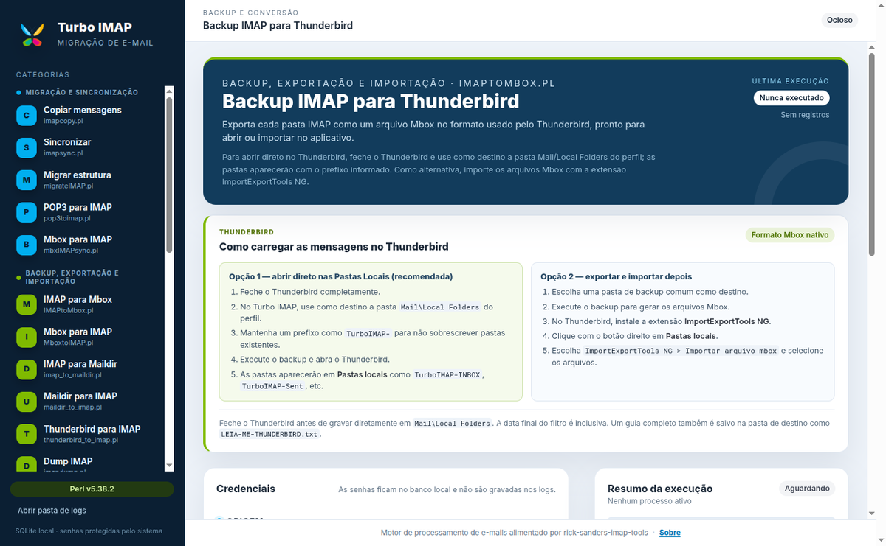
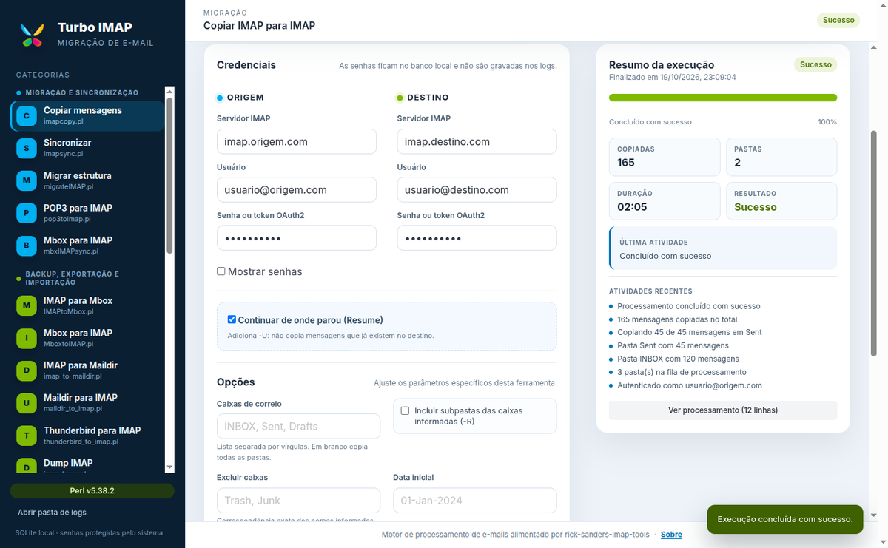
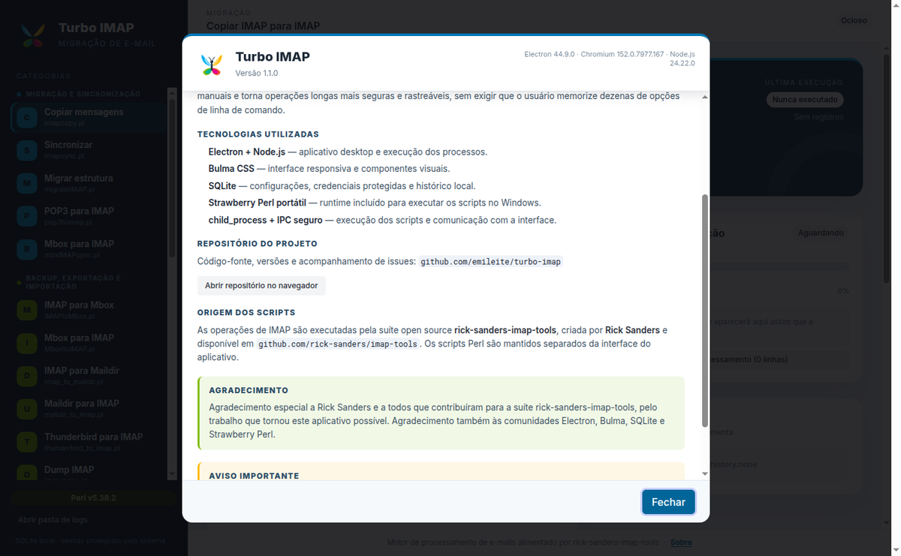

# Turbo IMAP

**Português (Brasil)** | [English](README.md)


Aplicativo desktop para **migração, backup, exportação, importação, limpeza e
diagnóstico de contas de e-mail IMAP**, com interface gráfica em português.

O Turbo IMAP reúne a suíte open source
[rick-sanders-imap-tools](https://github.com/rick-sanders/imap-tools) em formulários
guiados, executa os scripts Perl em subprocessos, acompanha o progresso, grava logs e
mantém o histórico de cada ferramenta.

**Repositório oficial:** <https://github.com/emileite/turbo-imap>  
**Site oficial:** [English](https://emileite.github.io/turbo-imap/) | [Português](https://emileite.github.io/turbo-imap/pt.html)  
**Downloads:** [Releases](https://github.com/emileite/turbo-imap/releases)

---

## Capturas de tela

### Tela principal



### Resumo amigável da execução

O terminal completo fica recolhido em **Ver processamento**, enquanto o resumo mostra
andamento, mensagens, pastas, duração, resultado e atividades recentes.



### Sobre o aplicativo



<p align="center">
  
</p>

---

## O que o Turbo IMAP faz

- Detecta o idioma do computador: português (pt-BR) ou inglês (en).
- Organiza 25 ferramentas em quatro categorias: migração, backup/conversão, limpeza e
  auditoria/diagnóstico.
- Preenche formulários específicos para cada script, com validação de campos e montagem
  segura dos argumentos.
- Salva credenciais e a última configuração de cada ferramenta em SQLite.
- Executa os scripts Perl em subprocessos, sem travar a interface.
- Exibe um resumo amigável e mantém o retorno completo do terminal em um bloco recolhido.
- Grava logs completos por execução e snapshots de progresso em JSON.
- Permite interromper uma execução em andamento.
- Oferece filtros de data inicial/final nas ferramentas que suportam intervalo.
- Implementa Resume de acordo com o recurso de cada script.
- Exporta pastas IMAP em Mbox prontos para abrir no Thunderbird.
- Inclui Strawberry Perl portátil no instalador Windows e valida o `sqlite3` nativo
  correto antes do empacotamento.

---

## Ferramentas disponíveis

### Migração e Sincronização

| Ferramenta | Script | Descrição | Resume |
| --- | --- | --- | --- |
| Copiar IMAP para IMAP | `imapcopy.pl` | Copia pastas e mensagens entre contas IMAP, com filtros e modo de atualização. | `-U` |
| Sincronizar contas IMAP | `imapsync.pl` | Compara origem e destino e sincroniza mensagens e flags. | natural |
| Migração estrutural de contas | `migrateIMAP.pl` | Migra contas inteiras com mapeamento de pastas. Gera o arquivo de usuários exigido pelo script. | `-U` |
| Migrar POP3 para IMAP | `pop3toimap.pl` | Baixa mensagens de um servidor POP3 e envia para uma conta IMAP. | não |
| Sincronizar Mbox local com IMAP | `mbxIMAPsync.pl` | Mantém uma pasta IMAP alinhada a um arquivo Mbox local. | natural |

### Backup, Exportação e Importação

| Ferramenta | Script | Descrição | Resume |
| --- | --- | --- | --- |
| Backup IMAP para Thunderbird | `IMAPtoMbox.pl` | Exporta cada pasta como Mbox para abrir nas Pastas Locais do Thunderbird ou importar com ImportExportTools NG. | `-n` |
| Backup IMAP para Mbox | `IMAPtoMbox.pl` | Gera arquivos Mbox a partir das pastas IMAP. | `-n` |
| Importar Mbox para IMAP | `MboxtoIMAP.pl` | Envia arquivos Mbox locais para o servidor. | não |
| Backup IMAP para Maildir | `imap_to_maildir.pl` | Salva as mensagens no formato Maildir, com um arquivo por mensagem. | não |
| Importar Maildir para IMAP | `maildir_to_imap.pl` | Envia uma estrutura Maildir local para o servidor IMAP. | não |
| Importar perfil Thunderbird | `thunderbird_to_imap.pl` | Lê o perfil local do Thunderbird e envia as mensagens para o IMAP. | `-U` |
| Dump da estrutura IMAP | `imapdump.pl` | Despeja a estrutura bruta do servidor em disco. | `-U` |
| Importar dump IMAP | `dumptoIMAP.pl` | Restaura um dump criado pelo `imapdump.pl`. | não |

### Limpeza e Manutenção

| Ferramenta | Script | Descrição |
| --- | --- | --- |
| Remover duplicatas | `delIMAPdups.pl` | Detecta e opcionalmente purga mensagens duplicadas. |
| Excluir pastas em massa | `delete_imap_mailboxes.pl` | Exclui pastas por expressão regular, com modo de teste. |
| Limpar uma pasta | `purgeMbx.pl` | Remove definitivamente todas as mensagens de uma pasta. |
| Gerenciar a lixeira | `trash.pl` | Gerencia e esvazia a lixeira da conta. |
| Aplicar filtros no servidor | `imapfilter.pl` | Executa regras de filtro diretamente no IMAP. |

### Auditoria, Diagnóstico e Informação

| Ferramenta | Script | Descrição |
| --- | --- | --- |
| Tamanho das contas | `list_account_sizes.pl` | Calcula o tamanho total e por pasta. |
| Listar pastas e mensagens | `list_imap_folders.pl` | Lista a árvore de pastas e a quantidade de mensagens. |
| Auditar duas contas IMAP | `imap_audit.pl` | Compara origem e destino, inclusive por data. |
| Busca avançada no IMAP | `imap_search.pl` | Executa critérios de busca diretamente no servidor. |
| Testar conexão IMAP | `imapPing.pl` | Valida conectividade e login. |
| Recursos do servidor | `imapCapability.pl` | Lista extensões e recursos suportados, como IDLE e QUOTA. |
| Testar login OAuth2 | `test_oauth2_login.pl` | Testa autenticação XOAUTH2 no Gmail. |

> As ferramentas destrutivas exibem confirmação. Quando o script oferece modo de teste,
> ele vem ativado por padrão.

---

## Como funciona

```text
┌──────────────────────────────┐
│ Renderer (Bulma + JS)        │
│ formulários, resumo e logs   │
└──────────────┬───────────────┘
               │ IPC seguro (contextBridge)
┌──────────────▼───────────────┐
│ Preload                      │
└──────────────┬───────────────┘
               │
┌──────────────▼───────────────┐
│ Main process (Electron)      │
│ ├─ SQLite (configs/histórico)│
│ ├─ Executor (spawn)          │
│ └─ Logs e progresso          │
└──────────────┬───────────────┘
               │ child_process.spawn
┌──────────────▼───────────────┐
│ Strawberry Perl + scripts .pl│
└──────────────────────────────┘
```

### Fluxo de uma execução

1. O usuário seleciona uma ferramenta no menu.
2. O aplicativo carrega a última configuração daquela ferramenta no SQLite.
3. O formulário é montado dinamicamente a partir de `src/shared/tools.js`.
4. Ao executar, o processo principal valida os dados e monta os argumentos do script.
5. O script Perl é iniciado via `child_process.spawn`.
6. `stdout` e `stderr` são lidos linha a linha e gravados em `logs/`.
7. Expressões regulares extraem progresso e atividades do terminal.
8. O renderer recebe eventos por IPC e atualiza o resumo, a barra e o log recolhido.
9. Ao final, o status e o histórico são gravados no SQLite.

### Resumo e processamento

- **Resumo da execução:** status, mensagens, pastas, duração, resultado, última
  atividade e atividades recentes.
- **Ver processamento:** abre o bloco oculto com o retorno completo do terminal,
  incluindo a contagem de linhas e as opções de rolagem e limpeza.
- **Histórico:** últimas execuções da ferramenta, com acesso ao log.

### Filtros de data

As ferramentas de cópia, backup e auditoria aceitam **Data inicial** e/ou **Data final**
no formato `DD-MMM-YYYY`. A data final é inclusiva. O filtro é aplicado pelo próprio
script Perl, que suporta `-a` (a partir de) e `-b` (até) quando disponível.

Ferramentas com intervalo completo: cópia IMAP, migração estrutural, IMAP para Maildir,
IMAP para Mbox, IMAP para Thunderbird e auditoria de contas.

### Resume

O checkbox **Continuar de onde parou (Resume)** é traduzido para a flag correta:

- `imapcopy.pl`, `migrateIMAP.pl`, `imapdump.pl` e `thunderbird_to_imap.pl`: `-U`.
- `IMAPtoMbox.pl` e o backup para Thunderbird: `-n`, evitando mensagens já existentes.
- `imapsync.pl` e `mbxIMAPsync.pl`: sincronização natural por comparação.
- Demais ferramentas: retomada não disponível; o checkbox fica desabilitado.

---

## Backup para Thunderbird

O Thunderbird usa **Mbox** como formato nativo das Pastas Locais. O Turbo IMAP exporta
uma pasta IMAP por arquivo Mbox, preservando o conteúdo das mensagens.

### Opção 1 — abrir direto no Thunderbird (recomendada)

1. Feche o Thunderbird completamente.
2. Selecione **Backup IMAP para Thunderbird**.
3. Use como destino a pasta
   `...\Thunderbird\Profiles\<perfil>\Mail\Local Folders`.
4. Mantenha o prefixo `TurboIMAP-` para não sobrescrever `Inbox`, `Sent`, etc.
5. Execute o backup e abra o Thunderbird.
6. As pastas aparecem em **Pastas locais** como `TurboIMAP-INBOX`, `TurboIMAP-Sent`, etc.

O aplicativo grava um guia `LEIA-ME-THUNDERBIRD.txt` na pasta de destino e exibe as
instruções dentro da própria ferramenta.

### Opção 2 — exportar e importar depois

1. Exporte para uma pasta de backup comum.
2. No Thunderbird, instale a extensão **ImportExportTools NG**.
3. Clique com o botão direito em **Pastas locais**.
4. Escolha **ImportExportTools NG → Importar arquivo mbox**.
5. Selecione os arquivos gerados.

---

## Segurança

- O renderer roda com `contextIsolation` e sem `nodeIntegration`.
- Todo acesso ao Node/Electron passa por `src/preload/preload.js`.
- Senhas são armazenadas com `safeStorage` do Electron quando disponível. Em ambientes
  sem cofre, o MVP usa ofuscação base64 local.
- Senhas são removidas dos logs e da linha de comando registrada.
- Os scripts Perl originais recebem a senha como argumento de linha de comando, portanto
  ela pode ser visível para outros processos do mesmo usuário durante a execução.
- Ferramentas de exclusão exigem confirmação e mantêm modo de teste quando disponível.
- Faça backup antes de operações destrutivas.

---

## Download e instalação

Baixe o instalador mais recente em
[Releases](https://github.com/emileite/turbo-imap/releases):

- Windows x64: `Turbo IMAP Setup <versão>.exe` (~158 MB). Inclui **Strawberry Perl
  5.42.3.1** portátil e o `sqlite3` nativo Windows.
- Linux x64: `Turbo IMAP-<versão>.AppImage` (~127 MB). Requer `perl` no `PATH`.
- macOS Intel: `Turbo IMAP-<versão>-mac.zip`; macOS Apple Silicon:
  `Turbo IMAP-<versão>-arm64-mac.zip`. São zips sem assinatura e requerem `perl` no
  `PATH`.
- No GNU/Linux, torne o AppImage executável com `chmod +x` antes de abrir.
- No macOS, o Gatekeeper pode bloquear o app sem assinatura. Use **Abrir** com o botão
  direito ou execute `xattr -dr com.apple.quarantine "Turbo IMAP.app"`.
- O instalador Windows não possui assinatura digital; o SmartScreen pode exibir aviso.

---

## Desenvolvimento

### Requisitos

- Node.js 20 ou superior.
- Linux/macOS: `perl` no PATH para desenvolvimento.
- Windows: o runtime portátil em `vendor/strawberry/` é usado automaticamente.

### Rodando

```bash
npm install
npm start
```

O `postinstall` copia o Bulma para `src/renderer/vendor/`.

### Runtime do Perl

```bash
npm run prepare:perl
```

Na primeira execução, baixa o Strawberry Perl portátil oficial (~291 MB), valida o
SHA256 e extrai apenas o runtime necessário para `vendor/strawberry/`. O `npm run build`
executa essa etapa automaticamente.

Para usar outro executável de Perl:

```bash
TURBO_IMAP_PERL=/caminho/para/perl npm start
```

No PowerShell:

```powershell
$env:TURBO_IMAP_PERL="C:\Strawberry\perl\bin\perl.exe"; npm start
```

### Builds

```bash
npm run build:win     # instalador Windows x64
npm run build:linux   # AppImage Linux x64
npm run build:mac     # zips macOS x64 e arm64 sem assinatura
```

Cada build prepara o prebuild N-API do `sqlite3` para a plataforma e arquitetura corretas.
O build Windows também prepara o runtime portátil do Perl.

Saída:

```text
dist/Turbo IMAP Setup 1.1.0.exe
dist/Turbo IMAP-1.1.0.AppImage
dist/Turbo IMAP-1.1.0-mac.zip
dist/Turbo IMAP-1.1.0-arm64-mac.zip
```

> A criação de DMG e a assinatura de código do macOS exigem macOS. O build no Linux gera
> `.zip` sem assinatura, que ainda podem ser abertos localmente.

Para gerar apenas a pasta desempacotada:

```bash
npm run build:dir
```

Ao alternar entre build Windows e desenvolvimento local em Linux, restaure o `sqlite3`
nativo da plataforma local:

```bash
npm run restore:sqlite:linux
```

---

## Onde ficam os dados

Em desenvolvimento, na raiz do projeto:

- `turbo-imap.db` — configurações e histórico.
- `logs/` — um log completo por execução.
- `progress/` — snapshots JSON do progresso.

No aplicativo empacotado, esses dados ficam no `userData` do Electron
(`%APPDATA%/turbo-imap` no Windows). O botão **Abrir pasta de logs** leva até eles.

---

## Estrutura do projeto

```text
assets/               logo, ícones Windows/macOS e splash
docs/                 landing page e capturas de tela em inglês/português (GitHub Pages)
logs/                 logs gerados em tempo de execução
progress/             snapshots de progresso
scripts/              suíte rick-sanders-imap-tools (.pl)
src/locales/          traduções em inglês e português
src/main/             main, SQLite e executor de processos
src/preload/          ponte IPC segura
src/renderer/         interface Bulma, formulários, resumo e modal Sobre
src/shared/           definições das ferramentas, argumentos e i18n
tools/                preparação do Perl/sqlite, logo e Bulma
vendor/strawberry/    runtime portátil do Perl para o build Windows
```

---

## Solução de problemas

**“Perl não encontrado”**
- No Windows, reinstale o aplicativo a partir do instalador recente.
- Em desenvolvimento, rode `npm run prepare:perl` ou defina `TURBO_IMAP_PERL`.

**“node_sqlite3.node is not a valid Win32 application”**
- Corrigido a partir da versão 1.0.3; use o instalador recente.
- O build prepara o prebuild Windows x64 e desativa `npmRebuild`.

**“`uname` is not recognized”**
- Corrigido no `imap_to_maildir.pl`; use a versão 1.0.2 ou superior.

**“Out of memory in perl:util:safesysrealloc”**
- Corrigido com streaming de mensagens no `imap_to_maildir.pl` e `IMAPtoMbox.pl`.

**Pastas não aparecem no Thunderbird**
- Feche o Thunderbird antes de gravar em `Mail\Local Folders`.
- Confirme o perfil correto em Ajuda → Informações para solução de problemas.
- Reabra o Thunderbird; se necessário, use ImportExportTools NG.

**SmartScreen**
- O instalador não é assinado digitalmente. Verifique a origem do download.

**Senhas com separadores**
- No formato `host/usuário/senha`, a senha não pode conter `/`.
- Em arquivos de usuários de `migrateIMAP.pl` e `maildir_to_imap.pl`, os separadores
  internos são `:` e `,`, respectivamente.

---

## Tecnologias

- [Electron](https://www.electronjs.org/) — aplicativo desktop.
- [Node.js](https://nodejs.org/) — processos, IPC e ferramentas de build.
- [Bulma](https://bulma.io/) — interface CSS.
- [SQLite](https://www.sqlite.org/) — configurações, credenciais e histórico.
- [Strawberry Perl](https://strawberryperl.com/) — runtime Perl portátil para Windows.
- [rick-sanders-imap-tools](https://github.com/rick-sanders/imap-tools) — scripts de
  operação IMAP.

---

## Créditos e licença

Agradecimento especial a **Rick Sanders** e a todos que contribuíram para a suíte
[rick-sanders-imap-tools](https://github.com/rick-sanders/imap-tools), que executa as
operações IMAP deste aplicativo. Agradecimento também às comunidades Electron, Bulma,
SQLite e Strawberry Perl.

O código do Turbo IMAP é distribuído sob a licença **MIT**. Os scripts Perl mantêm a
licença original da suíte, incluída em `scripts/license.txt`.

**Repositório:** <https://github.com/emileite/turbo-imap>  
**Issues:** <https://github.com/emileite/turbo-imap/issues>
